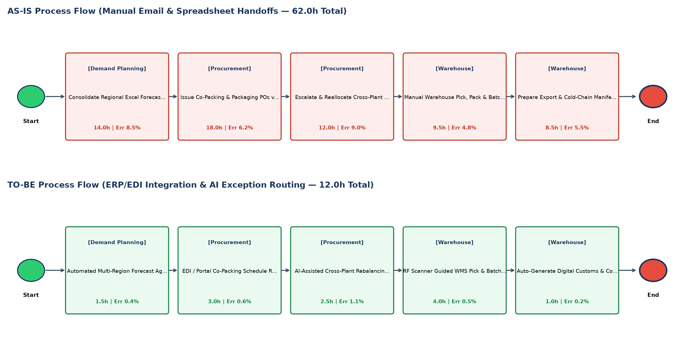
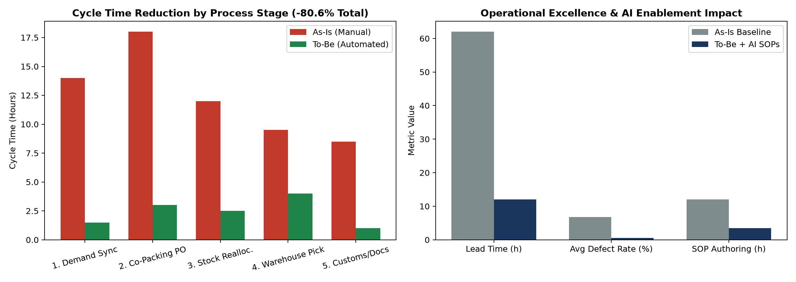

# Global Supply Chain Process Modelling & AI-Enabled Documentation Toolkit

End-to-end **Business Process Management (BPM)**, **BPMN 2.0 Modelling**, **AI-Assisted Process Documentation**, and **Executive Excel/PowerPoint** toolkit designed for global supply chain operations.

## BPMN 2.0 Process Landscape (As-Is vs. To-Be)



## Supply Chain Cycle Time & AI Enablement Impact



## Core Deliverables & Architecture
- **BPMN 2.0 Process Models (`processes/bpmn/`):** Valid BPMN 2.0 XML definitions modeling cross-functional swimlanes (*Demand Planning*, *Procurement & Co-Packing*, *Warehouse & Distribution*) across **As-Is** (62.0h lead time) and **To-Be** (12.0h automated lead time) workflows.
- **AI-Assisted SOP & RACI Generator (`src/ai_sop_generator.py`, `processes/sops/`):** Automatically parses BPMN 2.0 XML workflows to generate standardized Standard Operating Procedures (SOPs), RACI governance matrices, and role-based user onboarding checklists (~71% faster documentation effort).
- **Executive Process Review Workbook (`deliverables/excel/supply_chain_process_review.xlsx`):** Multi-tab `openpyxl` model with dynamic Excel formulas, stage-by-stage bottleneck analysis, AI documentation ROI metrics, and embedded charts.
- **Executive Rollout Presentation (`deliverables/powerpoint/process_optimization_pitch.pptx`):** 4-slide stakeholder presentation generated via `python-pptx` covering process discovery, BPMN optimization, and a 6-month implementation roadmap.

## Quickstart
```powershell
python -m venv .venv
.\.venv\Scripts\Activate.ps1
pip install -r requirements.txt
python -m src.build_deliverables
pytest
```
